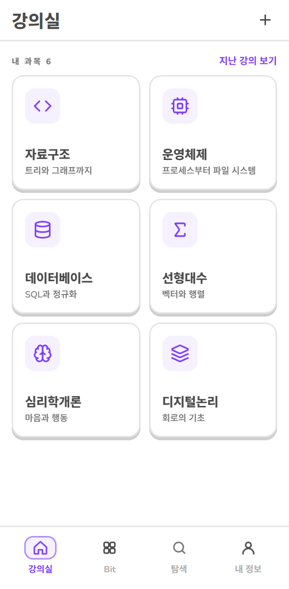
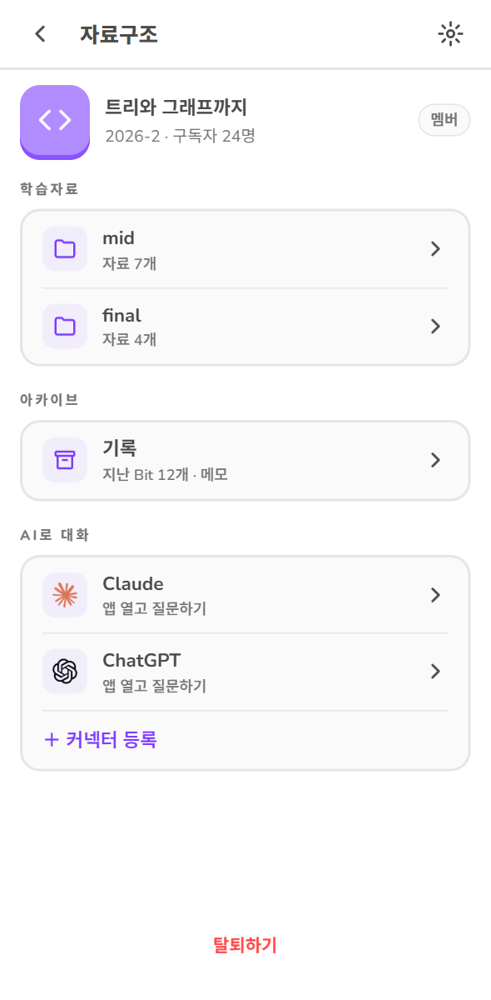
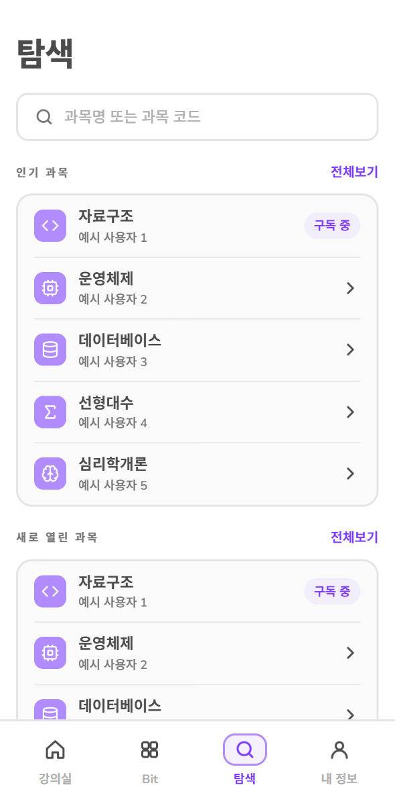

# Daybit

> 같은 수업 사람들이 강의자료를 모으고, 그 자료로 매일 한 조각(Bit)씩 함께 공부를 시작하는 곳

2026-2 멋쟁이사자처럼 1호선톤 · 주제 "AI로 다시 그리는 학습과 성장" · 프론트엔드 3명

[서비스](https://daybit-app.vercel.app) · [팀 저장소](https://github.com/RailLine1/FE) · [기획 문서](https://github.com/RailLine1/Docs) · [개발 안내](docs/development.md)

## 서비스

| 기능 | 사용자 경험 |
| --- | --- |
| 강의실 | 과목별로 자료를 모으고 같은 수업 사람들과 공유한다. |
| Bit | 강의자료로 만든 문제를 매일 풀고, 함께한 기록을 남긴다. |
| 커넥터(MCP) | 평소 쓰는 Claude·ChatGPT가 과목 자료를 찾아 읽고 근거와 함께 답한다. |
| 탐색 | 공개 과목을 구독하거나 과목 코드로 가입을 요청한다. |

사람은 자료를 모으고 공유 범위를 정하며, AI는 그 자료 안에서 근거를 찾아 답한다.

## 화면

| 강의실 | 과목 상세와 AI 대화 | 탐색 |
| :---: | :---: | :---: |
|  |  |  |

<sub>예시 데이터로 실행해 캡처한 화면이다.</sub>

## 본인 역할 ([leeeeeseojin](https://github.com/leeeeeseojin))

과목을 찾고, 만들고, 함께 운영하는 흐름을 맡았다.

| 영역 | 한 일 |
| --- | --- |
| 강의실 | 홈, 지난 강의, 과목 상세, 과목 만들기와 완료, 자료 폴더와 업로드, 기록과 게시글 |
| 과목 운영 | 관리자·멤버별 환경설정, 멤버 관리, 가입 요청 처리, 권한별 탈퇴 |
| 탐색 | 검색, 전체보기, 과목 정보와 구독 |
| 사람에서 에이전트로 | 과목 맥락을 담은 질문으로 AI 앱을 여는 "AI로 대화" 초기 구현 |
| 연동과 기반 | 맡은 화면의 API 연동, 공통 컴포넌트, PR 검사 CI |

Bit 퀴즈, 온보딩, 내 정보, 커넥터 안내, 테마와 마스코트는 다른 팀원들이 주로 구현했다.

## 기술

React Native · Expo Router · TypeScript · TanStack Query · Orval · GitHub Actions · Vercel

## 실행

```bash
npm ci
cp .env.example .env.local
npm run web
```
